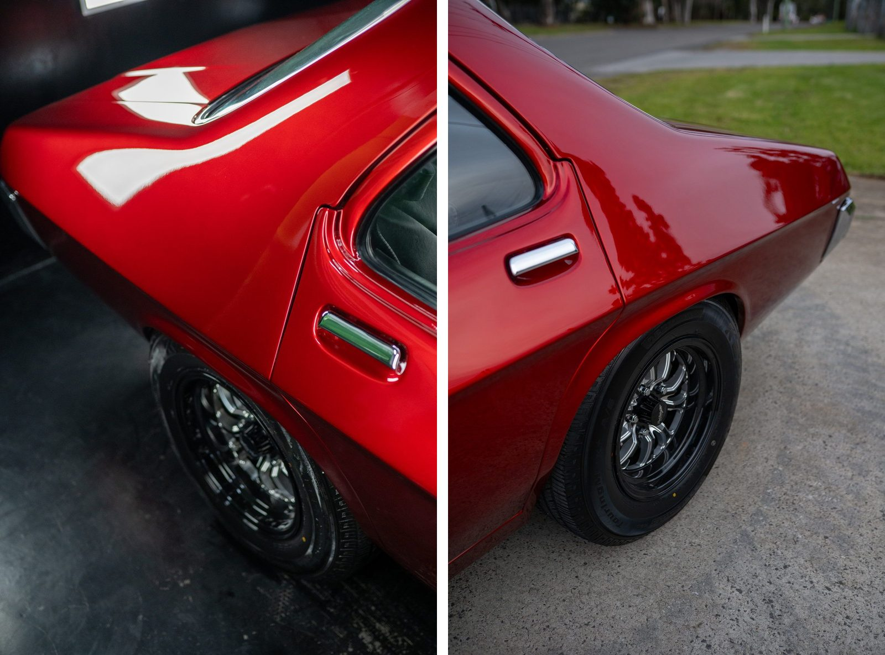
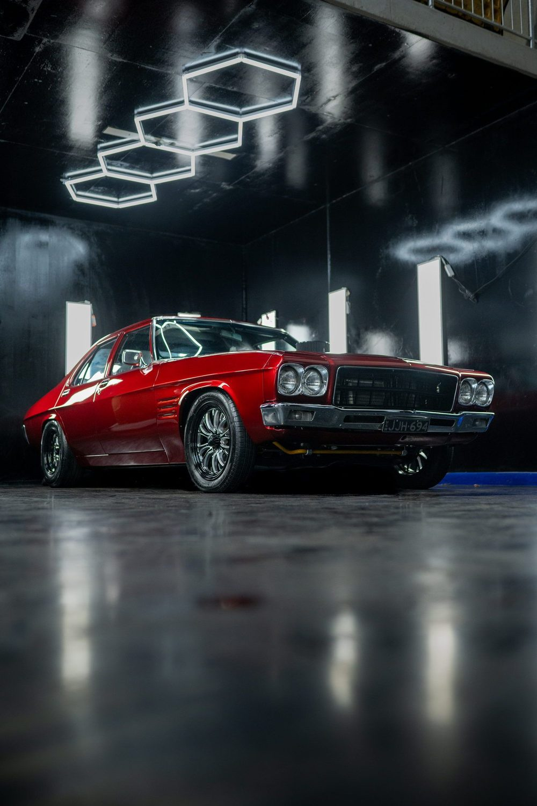

Car detailing before and after photos are the strongest thing a detailer can put on a website or a Google listing. They are also the easiest to get wrong. The short answer: shoot the before from a fixed spot, mark that spot, and shoot the after from exactly the same place under the same light. Everything else on this page is detail on that one rule.

I photograph cars for detailers, workshops and owners around Bathurst. The same few problems turn up again and again in phone photos of detailing work, and none of them need better gear to fix.

## Why most before and after photos do not convince anyone

A customer looking at a pair of photos is trying to answer one question: is the difference the work, or the photo? If anything other than the paint has changed between the two frames, they cannot tell, and the comparison stops doing its job.

The usual culprits:

- **Different light.** The before is under the shed's fluoros at 7 am, the after is outside in afternoon sun. Of course the after looks better. So would the before.
- **Different angle.** The before is a quick shot from the driver's side, the after is a low three-quarter hero angle. The viewer is comparing two photos, not two finishes.
- **Different distance.** Swirls that fill the frame in the before are invisible in an after taken from three metres back.
- **A filter or heavy edit on one side only.** People notice this faster than you would think, and once they do they stop trusting the rest of your gallery.

## How to take car detailing before and after photos

This works on any phone made in the last few years.

1. **Pick the panels before you touch the car.** Choose the two or three spots where the change will be most obvious: a bonnet with swirls, a scratched door, a stained seat, a faded headlight. Do not try to document the whole car.
2. **Mark where you stood.** A strip of painter's tape on the floor, or a note of which bay post you were beside. If you can, put the phone on a cheap tripod and leave it set up for the after.
3. **Note the light.** Same bay, same door open or shut, same lights on. If you shoot the before outside, shoot the after outside at a similar time of day, or move both indoors.
4. **Turn off anything automatic you can.** Portrait mode, beauty filters and HDR effects all change how paint looks between frames. Plain photo mode, no zoom, no filters.
5. **Shoot the before first, every time.** It is easy to forget once the foam cannon is out. Make it the first thing you do when the car rolls in, before the mats come out.
6. **For paint, find a reflection.** Swirls and holograms only show where a light reflects in the panel. Move until a light source sits in the area you are shooting, then take the photo. Do the same for the after so the reflection proves the correction.
7. **Shoot the after from the tape mark.** Same height, same distance, same zoom. Check the before on screen and line the two up.

Those two frames are from a shoot on the [automotive photography page](/photography/automotive.html). Both are honest. The studio panels show every reflection in the corrected paint; the daylight outside is softer and shows the shape and colour. That is exactly why you pick one and stick to it for a comparison.

## What to photograph for each kind of job

Pick one before and its matching after for each kind of job:

- **Paint correction.** Before: a panel with a light reflecting in it, close enough to see the swirls. After: the same panel, same light, same reflection.
- **Ceramic coating.** Before: gloss and colour on one panel, with a light reflecting in it. After: the same shot, plus a close-up of water beading.
- **Interior detail.** Before: seats, carpets and cup holders from the open door. After: the same door, the same angle.
- **Headlight restoration.** Before: straight on, about a metre away. After: the same distance and height.
- **Wheels.** Before: the inside of the barrel with the brake dust. After: the same wheel, rolled so the valve sits in the same spot.

## Use one good delivery shot as well

A comparison proves the work. A single clean photo of the finished car sells the feeling. When the job is done, take one shot that is not about evidence at all: the whole car, in the best light you have, from a low three-quarter front angle.

If you have a studio with panel lights, use them. If you do not, the hour after sunrise or before sunset outside does a lot of the work for you. Avoid harsh midday sun, which puts hard white spots on the paint and black shadows under the car.

## Where to put the photos so they get you work

Good photos sitting in your camera roll do nothing. Put them where people decide who to book:

- **Your Google Business Profile.** Add a few pairs after each good job, not a hundred at once. My [Google Business Profile checklist](/guides/google-business-profile-checklist.html) covers the rest of the listing.
- **Each service page on your website.** Paint correction photos on the paint correction page, interiors on the interior page. A gallery on its own page is fine, but the photos earn more next to the service they prove. When I rebuilt the site for [CME Detailing](/work/cme-detailing.html), each service got its own page with room for exactly this.
- **Social posts.** A two-image carousel with the before first. Say what the problem was and what you did in one or two lines.

Name the files before you upload them. A file called `paint-correction-before-holden-bonnet.jpg` tells a search engine more than `IMG_4821.jpg`, and it takes ten seconds. Write a short description for each photo on your website as well, saying what it shows.

## Keep it honest

Edit both photos the same way or not at all. If you straighten or crop the before, do the same to the after. Do not brighten the after more than the before, and never remove a defect in editing that was not removed on the car. One customer who spots a doctored comparison costs you more than the photo was ever worth.

Get the owner's okay before you post their car, and blur or remove the number plate if they would rather it was not shown.

## When it is worth bringing in a photographer

Phone photos are right for day-to-day jobs and comparisons. A professional shoot earns its place for the photos that sit on your website for years: the home page, the top of each service page, and the cars you are proudest of. If you are planning one, the [guide to preparing for a commercial photo shoot](/guides/prepare-for-a-commercial-photo-shoot.html) covers what to sort out beforehand.

I shoot in detailing studios and on location across Bathurst, Orange, Lithgow and the rest of the [Central West](/locations.html), and I build the websites the photos end up on. If you want a set of delivery shots or a site that shows your work properly, [get in touch](/contact.html).
