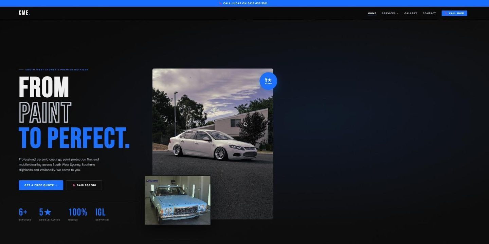

A website not showing up on Google is one of the most common things a business owner asks me about. Usually it is one of two different problems. Either Google does not have the site in its index at all, or it has the site but shows other businesses ahead of it. The fixes are completely different, so the first job is working out which one you have.

The short answer: search `site:` followed by your domain. If nothing comes back, it is an indexing problem and the cause is usually technical. If your pages come back but you cannot find yourself for "electrician Orange" or "dog groomer Mudgee", it is a ranking problem, and that is about content, your Google Business Profile and reputation.

## Step one: check whether Google has your site at all

Type `site:yourbusiness.com.au` into Google, with your own domain and no spaces. Google's own [guide to getting on Google](https://developers.google.com/search/docs/fundamentals/get-on-google) suggests exactly this check, with a caveat: the results do not necessarily list every page Google has. Treat it as a rough answer.

- **Nothing at all.** Google has not indexed the site. Read the next section.
- **Some pages but not the important ones.** Usually a quality or duplicate problem on those pages.
- **All the pages you expect.** Indexing is fine. Skip to the section on ranking.

For a proper answer, set up [Google Search Console](https://search.google.com/search-console). It is free, it is Google telling you directly what it has found, and it is where most of the fixes below get confirmed. If your developer has not set it up, ask them to, and make sure the account is in your name.

## Why a website does not show up on Google at all

### The site is new

Google finds sites by following links and by being told about them. A new site with no links pointing at it can sit unnoticed. Google says a new site can [take a few weeks](https://developers.google.com/search/docs/fundamentals/get-on-google) to be picked up, and the same goes for changes to an existing one. Submitting the site's sitemap in Search Console speeds up discovery, but it is a nudge, not a guarantee.

### Something is telling Google to stay away

This is the one I see most after a launch. While a site is being built, it is normal to hide it from search engines. Then it goes live and nobody switches the setting off.

In WordPress it is a single tick box under Settings, Reading, called "Discourage search engines from indexing this site". The [WordPress documentation](https://wordpress.org/documentation/article/settings-reading-screen/) explains that it adds a `noindex` instruction to every page. Other builders have their own version, often in an SEO or privacy setting. The other culprit is a `robots.txt` file left over from the build that blocks the whole site.

Search Console names both. In the Page indexing report, they show as "URL marked 'noindex'" and "URL blocked by robots.txt".

### The content is hard for Google to read

If the words on your pages are inside images, or the whole site is a single page that only builds itself after a script runs, Google may see far less than a visitor does. A home page that is one big photo with your services written on it reads as almost nothing.

### The site moved and the old addresses broke

A new domain, a new platform or a rebuild that changed every page's address can drop a site out of the results for weeks. When I rebuilt the [CME Detailing website](/work/cme-detailing.html), the careful part was finding every address Google had ever indexed, including ones from a previous version of the site, and redirecting each to its replacement. The steps are in my guide to [moving a website without losing rankings](/guides/move-website-without-losing-rankings.html).

## What the Page indexing report is telling you

Open Search Console, go to Indexing, then Pages. The list under "Why pages aren't indexed" looks alarming, but much of it is normal. Google's [help page for the report](https://support.google.com/webmasters/answer/7440203) explains each status. The ones a small site usually sees:

- **URL marked 'noindex'.** The page asks not to be indexed. Fix it only if you want that page in Google.
- **URL blocked by robots.txt.** The robots.txt file stops Google crawling the page. Same again: fix it if the page should be found.
- **Discovered, currently not indexed.** Google knows the page exists but has not crawled it yet. Usually you wait, and make sure other pages on the site link to it.
- **Crawled, currently not indexed.** Google read the page and chose to leave it out. If the page matters, make it more useful and more clearly different from your other pages.
- **Page with redirect.** An old address that now points somewhere else. Nothing to do.
- **Not found (404).** The address returns an error. Redirect it if the page moved.
- **Duplicate without user-selected canonical.** Google treats it as a copy of another page and indexes that one instead. Usually nothing to do.

The help page itself says not every page needs to be indexed. What matters is that your home page and your main service pages are. Use the URL Inspection tool at the top of Search Console to check those one at a time.

Once you have fixed something, you can ask Google to look again. URL Inspection has a "Request indexing" button for single pages, and a sitemap covers the rest. Google is plain that [requesting a crawl](https://developers.google.com/search/docs/crawling-indexing/ask-google-to-recrawl) does not guarantee the page will be included quickly or at all, and that crawling can take from several days to a few weeks. Pressing the button over and over does not speed it up.

## When Google has the site but you still cannot find it

If the `site:` search shows your pages, the problem is ranking. For a local business, that usually means two separate places: the map results and the ordinary results under them.

The map results come from your Google Business Profile. Google says local results depend on [relevance, distance and prominence](https://support.google.com/business/answer/7091), and that there is no way to pay for a better local ranking. You cannot change where the searcher is standing, so someone searching from Dubbo will usually be shown businesses near them before one based in Bathurst. You can control how complete your profile is and how many genuine reviews you have. My [Google Business Profile checklist](/guides/google-business-profile-checklist.html) goes through it.

The ordinary results depend much more on the website. The pages that rank for local searches tend to say plainly what the business does and where it does it, with a page for each main service rather than one page listing everything.

When I built the [Rural Asset Protection Solutions](/work/rural-asset-protection.html) site, the service, location and season pages were written before launch, so the site had some depth the first time Google crawled it. It was submitted through Search Console on launch day, so indexing problems would show up early instead of months later.

## A short checklist

1. Search `site:` with your domain and note what comes back.
2. Set up Search Console in the business's name and submit the sitemap.
3. Check for a leftover `noindex` setting or a robots.txt file blocking the site.
4. Make sure your services and towns are written as text on the page, not only in images.
5. If the site moved, check the old addresses redirect to the new ones.
6. Inspect your home page and main service pages in Search Console.
7. Complete your Google Business Profile and ask happy customers for reviews.

Most of this is an afternoon's work for the owner of a small site. If you get stuck, or the reports are not making sense, that is the kind of problem I sort out as part of [SEO for businesses in Bathurst and the Central West](/services/seo.html). Nobody can promise you a ranking, and I will not, but I can tell you plainly what is stopping Google from seeing your site. [Get in touch](/contact.html).
