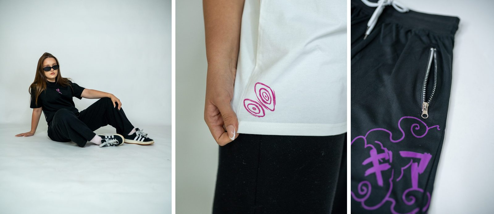

Working out how to photograph clothing for an online store is mostly a question of what to shoot, not what to shoot it with. The short answer: photograph every garment as the same small set of frames (front, back, full length, one or two close details), in the same light, on the same plain background, cropped to the same shape. A phone on a tripod beside a big window can do it. A set that is consistent across the whole range matters more than any single great photo.

I shoot apparel for online stores and build the stores the photos go into. The same gaps turn up on most small labels' product pages, and they are cheap to fix.

## What a customer needs to see before buying clothes online

Someone buying a tee in a shop picks it up, turns it over, feels the fabric and holds it against themselves. Online, your photos have to do all of that. Each one should answer a question the customer would otherwise have to guess at:

- **What is it?** A clear front view.
- **What is on the back?** The other side, even if it is plain.
- **How does it fit?** On a person, full length, so the cut and the drop are obvious.
- **What is it made of?** Close enough to see the weave, the print and the stitching.
- **What colour is it really?** The same in every frame, and the same as the thing that arrives in the post.

If a photo does not answer one of those, it is decoration. Decoration is fine for the home page and social posts, but it should not be taking up one of the first few places on a product page.

## The five shots every garment needs

This is the set I plan for each item:

1. **Front.** Straight on, garment filling most of the frame. This is usually the lead image, the one that shows on collection pages and in Google.
2. **Back.** Same distance, same height. Back prints sell garments, and a plain back is still information.
3. **Full length on a person.** Shows length, fit and what it looks like with other clothes. Note the model's height and the size they are wearing in the product description.
4. **Detail.** The print, embroidery, label or fabric, close up. This is where a customer zooms.
5. **Hardware or finish.** Zips, cuffs, hems, drawcords, pockets. One frame of whatever took effort to get right.

Those frames are from lookbook shoots for [Rokiovertime](/work/rokiovertime.html), a combat and training apparel label. Every garment in a drop gets the same list, which is why the product pages line up. There are more on the [apparel and product photography page](/photography/apparel-product.html).

Each colour needs its own photos. Google's product image rules ask for [one variant per image](https://support.google.com/merchants/answer/6324350?hl=en), matching its colour and pattern, and customers expect the same. A group shot of all four colourways is a nice extra, not a substitute.

## Flat lay, hanger, mannequin or model?

All four work. Pick by what the garment needs to show and how much time you have.

| Method | Good for | Watch out for |
|---|---|---|
| Flat lay | Tees, kidswear, accessories. Fast, cheap, easy to repeat | Says nothing about fit. Needs careful styling or it looks limp |
| Hanger | Quick additions to an existing range | Shoulders droop and the garment twists |
| Mannequin | Structured pieces, showing shape without booking anyone | A visible mannequin can look dated |
| Model | Anything where fit or attitude sells it | Takes the most time. Needs a signed release for commercial use |

A common mix for a small label is flat lays or on-model fronts and backs for every item, with full-length model frames for the pieces that lead the range. Whatever you choose, use it for the whole collection. A page with three flat lays, two hanger shots and one model photo looks like three different shops.

## A simple set-up that works

You do not need a studio to get a clean, repeatable result.

- **Light.** One big window with no direct sun on the garment, or a single large soft light. Turn the room lights off so you are not mixing colours of light. Put a white sheet or a piece of foam board on the side away from the window to lift the shadows.
- **Background.** Plain white, off-white or light grey. A roll of paper or an ironed sheet. Pale garments show up better on light grey than on pure white.
- **Camera.** A recent phone on a tripod is fine. Use the main rear camera, not the wide one, and stand back so the garment is not distorted. Mark where the tripod stands so every item is shot from the same spot.
- **Preparation.** Steam everything. Lint-roll dark fabric. Clip loose garments at the back for a clean line on a mannequin, but do not change how the fit looks on a model. My [guide to preparing for a commercial photo shoot](/guides/prepare-for-a-commercial-photo-shoot.html) has a fuller list.
- **Colour.** Set the white balance once and leave it. Check the first frame against the real garment, on a phone screen as well as a laptop, before you shoot the other forty.

## What size product photos Shopify and Google need

Shoot large and square, or at least leave room to crop square. The current numbers from the platforms themselves:

- **Shopify** accepts product images [up to 5000 x 5000 pixels and under 20 MB](https://help.shopify.com/en/manual/products/product-media/product-media-types), and says 2048 x 2048 usually displays best for square product images. It also asks for a consistent height-to-width ratio across lead images, so collection pages line up.
- **Google Merchant Center**, which feeds Google's Shopping results, is raising its minimum. Until now apparel images had to be at least 250 x 250 pixels. From [31 January 2027](https://support.google.com/merchants/answer/12159030?hl=en) every product image must be at least 500 x 500. Google's [image guidance](https://support.google.com/merchants/answer/6324350?hl=en) recommends about 1500 x 1500 or larger.
- **Google's lead image rules** are stricter than most stores realise. The same page says no overlaid text, prices, watermarks, borders or logos, and that the product should fill between 75 and 90 per cent of the frame.

If your store exports at 2048 pixels square, you are well clear of all of it. The stores likely to be caught by the January change are older ones with small images uploaded years ago, or shops pulling low-resolution photos from a supplier. If you are choosing a platform now, I compare the main ones in [Wix, Squarespace, WordPress, Shopify or hand-coded](/guides/website-platforms-compared.html).

Detail and lifestyle photos are not wasted on Google either. Its feed has separate slots for additional angles and for in-context images, so the full set can travel with the product.

## Edit lightly, and keep the colour true

Tidy up dust, loose threads and the odd crease. Leave the shape and the colour alone. A photo that makes a washed-black tee look jet black gets you a return and a bad review, not a sale. It can also be a legal problem. The ACCC counts [images of what is offered](https://www.accc.gov.au/consumers/advertising-and-promotions/false-or-misleading-claims) among the things a business must keep accurate, and tells businesses to check that the overall impression is true.

Export every lead image at the same size and shape, and name the files for what they show. `charcoal-tee-back-print.jpg` is more use to a search engine, and to you in six months, than `IMG_2207.jpg`.

## When to shoot it yourself and when to hire a photographer

Shoot it yourself when the range changes weekly, the items are one-offs, or you are testing whether something sells. A consistent phone set-up beats waiting.

Bring in a photographer when a collection will be on sale for months, when fit and mood are what you are selling, or when you need photos and video from the same day. The lead images and the launch set are where it pays off. Restocks and one-offs can stay on the phone, shot to match.

I shoot product sets and lookbooks around Bathurst, Orange and the rest of the [Central West](/locations.html), and I build [online stores](/services/ecommerce.html) on Shopify and WooCommerce, so the photos are cropped for the pages they are going on. If you have a range that needs shooting, or a store whose photos are letting it down, [get in touch](/contact.html).
