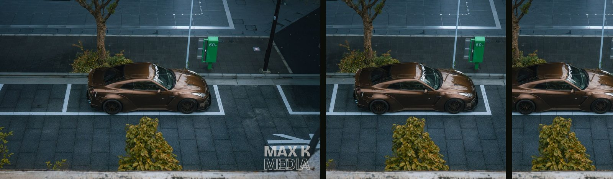

Social media video sizes look complicated because every platform publishes its own list. In practice a small business needs three shapes: vertical 9:16, square 1:1 and wide 16:9. The short answer: deliver vertical at 1080 x 1920 pixels for Reels, TikTok and Shorts, wide at 1920 x 1080 for your website and YouTube, and plan the shoot so the important part of every shot sits in the middle of the frame. Then one day of filming covers all of it.

I shoot and edit video for businesses around Bathurst and the Central West. The most common problem I see is not the wrong size. It is a video framed for one shape and then forced into another, with the product or the person's face cut off at the edge.

## The three shapes that cover almost everything

| Shape | Pixels | Where it goes |
|---|---|---|
| Vertical 9:16 | 1080 x 1920 | Instagram and Facebook Reels, TikTok, YouTube Shorts, Stories |
| Square 1:1 | 1080 x 1080 | Feed posts, some ads, places where vertical gets cropped |
| Wide 16:9 | 1920 x 1080 | Your website, YouTube, presentations, a TV in the shop |

You will see other numbers quoted, such as 4:5 for feed posts. They are worth knowing for paid ads, but for most local businesses those three cover the ground.

The shape decides more than the look. YouTube treats any video with a [square or vertical aspect ratio up to three minutes long](https://support.google.com/youtube/answer/15424877?hl=en) as a Short, and tells you to use a wider frame such as 16:9 if you want it treated as a normal video. So the same clip can end up in a completely different part of YouTube depending on how you export it.

## What changed on Facebook and Instagram

Two changes matter for anyone posting video for a business.

**Every Facebook video is now a reel.** In June 2025 Meta announced that all video on Facebook would be published as reels, [of any length or orientation](https://www.engadget.com/social-media/facebook-videos-are-all-just-going-to-be-reels-now-185807805.html), and that the video tab would be renamed. There is no longer a separate place for a "normal" video. A wide clip uploaded to your business page sits in the same feed as vertical ones, where it shows up small with bars above and below.

**Instagram reels can be much longer, but long ones travel less.** Buffer's review of [2.7 million reels](https://buffer.com/resources/instagram-reels-length), updated this month, puts the maximum at 20 minutes for accounts that have the longer limit. It also notes Instagram's own warning that reels over three minutes will not be recommended to new audiences. In Buffer's data, reels between 90 seconds and three minutes reached slightly more people than an account's usual reel, though they are careful to say the effect is modest. Longer is allowed. That does not make it a good idea for a business trying to reach people who do not follow it yet.

## How long should a business video be?

As long as the message needs and no longer. My rough guide for local businesses:

- **Ads and teasers:** a single idea, cut short. One product, one offer, one reason to tap.
- **Reels and Shorts:** under a minute for most things. Up to three minutes for a walk-through or a how-to that earns it.
- **Google Business Profile:** Google's own rule is [up to 30 seconds, up to 75 MB and 720p or higher](https://support.google.com/business/answer/6103862?hl=en). A short clip of the shop, the work or the team is enough.
- **Your website:** a minute or two for a brand or venue film on the home page. Longer how-to videos can live on YouTube and be embedded.

I cover the rest of the profile in the [Google Business Profile checklist](/guides/google-business-profile-checklist.html). Video is one of the easier things to add.

## Shoot wide, frame for the centre

This is the part that saves money. If I know a video is going to be cut into vertical, square and wide versions, I film in 4K wide and keep the subject in the middle third of the frame.

The numbers work out neatly. A 4K frame is 3840 x 2160 pixels. A vertical 9:16 slice from the middle of it is about 1215 x 2160, which is more than the 1080 x 1920 the platforms ask for. So one wide 4K clip can be cropped to a full-quality vertical version without upscaling. Shoot in 1080p and that same crop comes out at roughly 600 pixels wide, which looks soft on a phone.

The catch is composition. A crop only keeps what is in the middle.

That frame is a still from my [automotive gallery](/photography/automotive.html), but the rule is the same for video. A car side-on, a long counter or a row of machines is a wide subject. Cropped to vertical, it falls apart. For those shots I either film a separate vertical version on the day or move the camera so the subject runs towards the lens rather than across it. A person talking to camera, a product in hand or a single detail crops to any shape without trouble.

## Keep text out of the edges

Vertical video has furniture on top of it. The account name, the caption, the like and share buttons and the progress bar all sit over the bottom and right of a reel. Meta's advice for reel ads is to keep the [key message inside the safe zone](https://developers.facebook.com/blog/post/2024/11/07/unlock-the-power-of-reel-ads/) so it stays visible. In plain terms:

- Keep titles, prices and phone numbers in the middle of the frame, well clear of the bottom third.
- Do not put a logo in a corner. It will be under a button.
- Burn captions in for social, sitting above the lower third.
- Check the export on an actual phone, inside the app, before it goes live.

Sound matters too. The same Meta post says over 75 per cent of Reels views on Instagram are sound on, so music and clear speech are worth the effort. Captions still cover the people watching on mute.

## Video on your own website

Your site is the one place you control. A few rules keep video from slowing it down:

- **Do not autoplay a huge file.** Compress a web version and give it a poster image, so the page shows something before the video loads.
- **Wide for the page, vertical for the phone.** A home page hero can switch to a vertical cut on small screens.
- **Host long videos elsewhere.** A ten-minute how-to belongs on YouTube, embedded on the page.

A fast page matters more than a moving one. The [web design page](/services/web-design.html) has more on how I build for speed.

## Planning a shoot that covers every platform

Before any video shoot I ask where each clip will be posted. That one question sets the shot list:

1. List every place the video will run: reels, Google, website, ads.
2. Pick the hero shape. For most local businesses now, that is vertical.
3. Mark which shots must work in vertical and which only need to work wide.
4. Film the wide subjects twice, once for each shape, if they matter.
5. Leave space in the middle of the frame for captions and titles.

It is the same thinking as planning a photo shoot, and my guide to [preparing for a commercial photo shoot](/guides/prepare-for-a-commercial-photo-shoot.html) covers the people, place and timing side. For a product launch, stills and video on the same day share one set-up. That is how the [Rokiovertime](/work/rokiovertime.html) drops are done: lookbook photos and vertical ad cuts from the same sessions.

I shoot and edit [video for businesses](/video.html) in Bathurst, Orange, Lithgow, Mudgee and across the [Central West](/locations.html), delivered in vertical, square and wide from the same footage. If you have a launch, a venue or a service that needs filming, [get in touch](/contact.html) and tell me where it will be posted.
