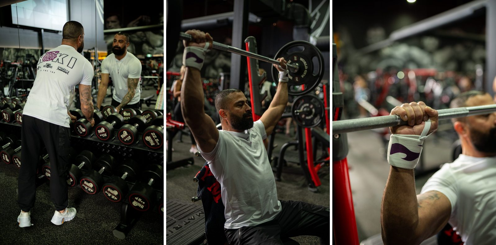
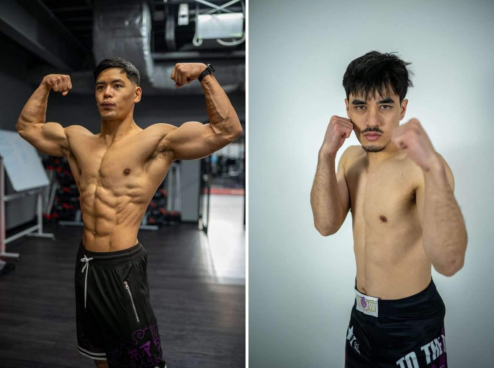

Good gym photography answers the question every new member is too nervous to ask: what is it actually like in there? The short answer for a gym or personal training website is six kinds of photo. The floor, the coaches, real members training, the classes, the details, and the front door. Shot in your own room, in your own light, with people who have agreed to be in them.

Most gym websites I look at around the Central West use the same stock images: a model with a perfect physique in a gym that is not theirs. A beginner in Bathurst or Orange looks at that and learns nothing, except that the place might not be for them.

## What gym photography is for

A gym's photos have three jobs, and they are different from a fashion shoot or an ad campaign.

- **Show the room.** Equipment, space, light, how busy it gets. Someone deciding between two gyms wants to see the squat racks, not a mood.
- **Show the people who will be there.** Coaches and members. A beginner wants to see someone who looks like them, at their level, not just your strongest member.
- **Give you content to use for months.** One planned session should cover the website, the Google listing and a run of social posts, so the next shoot is a choice and not an emergency.

If a photo does none of those, it does not need to be in the set.

## The gym photography shot list

This is the list I work from for a gym or studio. Print it, tick it off on the day.

| Shot | What it shows | Where it goes |
|---|---|---|
| The floor, wide | Layout, equipment, space and light | Home page, Google listing, "the gym" page |
| Coach portraits | Each coach on their own, looking at the camera | Team page, each PT's profile, booking pages |
| Coaching in action | A coach cueing a member mid-set | Personal training page, ads |
| Members training | Real members, a range of ages and levels | Home page, membership page, social |
| Classes | A class from the side or the back, mid-session | Timetable or classes page |
| Details | Hands on a bar, chalk, wraps, the plates, the signage | Section breaks, social, website backgrounds |
| Outside and the entry | Shopfront, parking, the door | Contact page, Google listing |

The last one gets skipped most and matters more than people think. A first-timer who has never been inside wants to know which door to walk through and where to park. One clear photo of the entry saves them a phone call they were never going to make.

## Wide, close and detail from the same session

Every part of the gym should be covered at three distances: a wide frame that sets the scene, a closer frame of someone working, and a detail. Together they tell the story. On their own, each one is a bit flat.

Those three frames are from a gym session I shot for the fightwear label [Rokiovertime](/work/rokiovertime.html). The brief was apparel in use, not gym marketing, but the principle is the same. The wide shows where you are, the action shows what happens there, and the detail is what makes someone stop scrolling. More from that session is in the [sport and fitness gallery](/photography/sport-fitness.html).

## Coach and personal trainer photos

For a personal trainer, the photo on your profile is often the first thing a client sees, on your website, your booking page and your Instagram. Plenty of personal trainer photoshoot ideas lean on the arms-crossed power pose. It has its place, but the photo that books sessions is usually simpler: you, looking at the camera, relaxed, in the gym where they will train with you.

Shoot two versions of each coach:

1. **On the floor.** In the gym, with equipment behind them, looking at the camera. This is the one for the team page.
2. **Plain background.** A wall or backdrop with nothing behind them. This one crops cleanly into a circle for a booking app or social profile, and still works if you renovate.

Keep every coach in the same style, with the same framing and the same background, so the team page looks like a team.

## Members, permission and the people who do not want to be photographed

This is the part to sort out before the photographer turns up, not on the day.

- **Ask first and get it in writing.** Only photograph members who have agreed, and keep a signed release on file for each person who appears clearly in a photo. I supply a simple release form for gym shoots.
- **Tell everyone before the day.** A note at the desk and in the members' chat a week ahead: the date, the time, and that anyone who would rather not be in shot can train at another time or tell me on the day.
- **Book the shoot in a quiet window.** A session booked for the shoot, with members who have opted in, is easier than working around a peak-hour floor.
- **Do not photograph children** for marketing without a parent's written consent, and think twice even then.

Use your photos the way people agreed. A member who said yes to the website did not necessarily say yes to a paid ad.

## Light, timing and what to wear

Most gyms are hard to photograph. The light is a mix of fluorescent tubes, LED strips and whatever comes through the roller door, and the colours fight each other. I work without flash on the floor, with fast lenses, so the photos look like the room actually feels and members are not being blinded mid-set.

A few things that help on your end:

- **Clean and clear the floor.** Re-rack the weights, coil the cables, move the mop bucket. It shows in every wide frame.
- **Turn every light on**, including the ones you usually leave off.
- **Coaches in uniform**, or at least in plain clothes without big logos that are not yours.
- **Train for real.** Ask the members to do their normal session. Staged reps look staged.

If you are planning a bigger shoot, the [guide to preparing for a commercial photo shoot](/guides/prepare-for-a-commercial-photo-shoot.html) covers the rest of the preparation.

## Where to put the photos

The photos only earn their keep once they are where people choose a gym.

- **Your Google Business Profile.** For a local gym this is often the first place people see you. Google asks for JPG or PNG files between 10 KB and 5 MB, recommends at least 720 by 720 pixels, and says the image should [represent reality](https://support.google.com/business/answer/6103862?hl=en-AU), so no heavy filters. My [Google Business Profile checklist](/guides/google-business-profile-checklist.html) covers the rest of the listing.
- **Your website.** The wide floor shot near the top of the home page, coach portraits on the team page, class photos next to the timetable. Give each file a short, descriptive name and write alt text saying what is in the frame. Google's own image guidance says to use [short but descriptive file names](https://developers.google.com/search/docs/appearance/google-images) and calls alt text the most important image attribute.
- **Social.** Space them out. A good session gives you weeks of posts. If you are filming at the same time, plan the shots so they crop cleanly for every format; I wrote about that in [shooting once for Reels, Shorts and your website](/blog/social-media-video-sizes.html).

If you post member transformation photos, the same rule as [before and after photos for detailers](/blog/detailing-before-after-photos.html) applies: same spot, same light, same distance, or the comparison means nothing.

## When to book a photographer

Phone photos are fine for the daily stuff: PBs, class shout-outs, a new piece of equipment. A planned shoot is worth it for the photos that sit on your website and Google listing for a couple of years: the floor, the coaches and the classes. Redo it when the fit-out changes or the team does.

I photograph gyms, studios, fighters and events around Bathurst, Orange, Lithgow and the rest of the [Central West](/locations.html), and I build the [websites](/services/web-design.html) the photos end up on. If your site is still running on stock images, [get in touch](/contact.html) and tell me about the gym.
