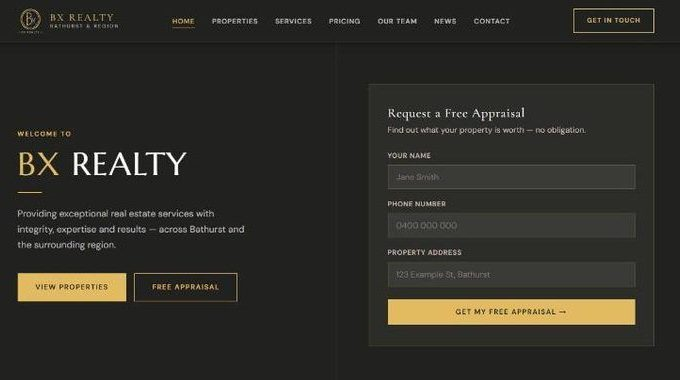

"Does my website need a privacy policy?" comes up on nearly every site I build. Usually right at the end, when someone notices the footer links to a page that does not exist yet.

The short answer for most small businesses in the Central West: yes, you should have one, even if the law does not strictly require it of you. Many small businesses are not covered by the Privacy Act, but some are regardless of size, and the tools most websites run on ask for a privacy policy in their own terms. It is a short page. Writing it honestly takes an hour or two.

I am a web developer, not a lawyer. What follows is the practical side: who is covered, what your website tools expect, and what goes on the page. If your business handles health records or anything sensitive, get proper legal advice as well.

## Does the Privacy Act apply to my small business?

Start here, because it decides whether a privacy policy is a legal requirement or just good practice.

According to [business.gov.au](https://business.gov.au/online-and-digital/cyber-security/protect-your-customers-information), a business with an annual turnover of more than $3 million must comply with the Privacy Act. Below that, most businesses are outside it. But some smaller businesses have to comply whatever their turnover. The examples given include:

- private sector health service providers, which the page says includes complementary therapists, gyms, weight loss clinics, childcare centres and private education providers
- businesses that sell or buy personal information
- contractors providing services under a contract with the Australian Government
- credit providers and credit reporting bodies
- residential tenancy database operators

The health one catches people out. A one-person personal training business or a small yoga studio in Orange can be covered in a way that a builder turning over far more is not. If you are anywhere near that list, check the Office of the Australian Information Commissioner's guidance for your situation rather than assuming you are exempt.

If you are covered, business.gov.au is direct about it: you need a clear and up-to-date privacy policy that sets out what information you collect, what you use it for and how you protect it. It also says it is a good idea to publish that policy on your website.

## Is the small business exemption going away?

Not yet. Removing it has been talked about for years, and a draft of the next round of Privacy Act changes was released for consultation in 2026. A summary from law firm [Sparke Helmore](https://www.sparke.com.au/insights/a-new-era-for-privacy-in-australia-implications-of-privacy-act-reform-tranche-2/) notes the draft bill makes no change to the small business exemption, so businesses under $3 million turnover stay outside the Act for now.

That is a draft, and the debate is not over. A decent policy written now means any future change is a matter of checking the page, not starting again.

## What your website collects without you thinking about it

Business.gov.au lists [what counts as personal information](https://business.gov.au/online-and-digital/cyber-security/protect-your-customers-information): a name, an email address or phone number, photos and videos, and an IP address, among other things. On a typical small business site, that turns up in more places than you would expect:

| On the site | What it collects |
|---|---|
| Contact or quote form | Name, email, phone, often an address and a message |
| Booking system | Name, contact details, appointment times, sometimes health notes |
| Online shop | Name, postal address, email, order history |
| Newsletter sign-up | Email address, sometimes a name |
| Analytics | Device details and how people move through the site, using cookies |
| Advertising pixels | Visits and actions, shared with the ad platform |
| Hosting | Server logs that usually include IP addresses |

Take the appraisal form on the [BX Realty site](/work/bx-realty.html) I built in Bathurst. It is three fields: name, phone number and property address. Every field on it is personal information. A privacy policy is simply where you say what happens to it after someone presses the button.

## Does my website need a privacy policy if I use Google Analytics?

This is the part that applies even if the Privacy Act does not.

If you run Google Analytics, you have agreed to its terms. Section 7 of the [Google Analytics Terms of Service](https://marketingplatform.google.com/about/analytics/terms/us/) says you must post a privacy policy, that it must give notice of your use of cookies or similar technology to collect data, and that you must disclose your use of Google Analytics and how it collects and processes data.

If you run the Meta pixel to track Facebook or Instagram ads, the [Meta Business Tools Terms](https://www.facebook.com/legal/terms/businesstools) ask for a clear and prominent notice on each page where the pixel is used, linking to an explanation of the tracking and how people can opt out of ad targeting.

So a gym that is covered by the Privacy Act, and a cafe that is not, both end up needing the same page the moment either one adds analytics or runs ads.

## What a small business privacy policy should cover

You do not need ten pages of legal language. You need an honest description of what you actually do. A policy copied from another business is worse than none, because it will describe tools and practices that are not yours.

Cover these, in plain words:

1. **Who you are.** Business name, ABN and how to contact you.
2. **What you collect.** List it by where it comes from: the contact form, bookings, orders, email, phone.
3. **Why.** To reply, to quote, to deliver the job, to invoice.
4. **Who else handles it.** Your form service, email provider, booking system, shop platform, analytics and ad platforms. Say that some may store data overseas if they do.
5. **Cookies and tracking.** Which tools set them and what they are for.
6. **How long you keep it**, and how it is protected.
7. **How people can ask** to see, correct or delete what you hold, and where to complain if they are not happy.
8. **The date** it was last updated.

My own [privacy page](/privacy.html) is an example of how short this can be when a site keeps things simple. This site has no analytics cookies or advertising trackers, so there is not much to explain. Every tool you add makes the page longer, which is a decent prompt to ask whether you need the tool at all.

## A new rule for businesses that are covered

For businesses that the Privacy Act does cover, there is one more change. From 10 December 2026, privacy policies have to explain certain uses of automated decision-making: where a computer program makes, or substantially helps make, a decision that could significantly affect someone, using their personal information. Law firm [Allens](https://www.allens.com.au/insights-news/insights/2026/10/mandatory-automated-decision-making-disclosure-requirements-are-coming-key-takeaways-from-the-oaic-guidance/) notes the regulator's guidance reads "computer program" broadly, covering rule-based tools, everyday software including spreadsheets, and chatbots.

Most sole traders will not need to worry about this. But if you are covered and you use software to approve, decline, price or screen customers, that is worth looking at with someone qualified before the date.

## Where the policy goes on the website

Put a link to it in the footer of every page, and near any form that collects details, so someone can read it before pressing send. Keep the address simple, like `/privacy.html` or `/privacy`. When you add a new tool, update the page and its date at the same time.

When I build or look after a site, the privacy page is written last, once I know exactly which tools the site runs. That is the only way it stays true. If you are planning a new site, my guide to [what to send your web developer](/guides/what-to-send-your-web-developer.html) lists what to have ready, and the [web design](/services/web-design.html) and [website maintenance](/services/website-maintenance.html) pages cover how I work.

## Need a hand with yours?

If your site has a privacy link that goes nowhere, a policy copied from somewhere else, or tracking you did not know was there, I can go through what your site actually collects and help you write a policy that matches it. I am based in Bathurst and work with businesses across the [Central West](/locations.html). I will not give you legal advice, but I will tell you plainly what your website is doing. [Get in touch](/contact.html).
