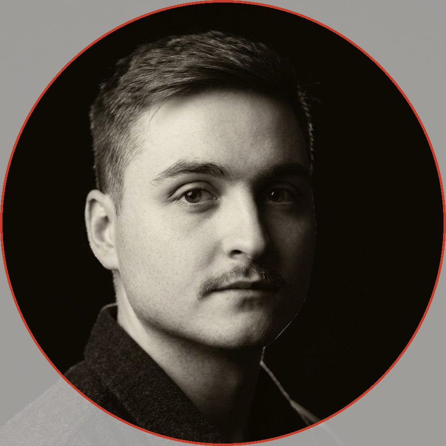

Business headshots are usually the last thing on the list when a website gets built. The staff page goes up with three phone photos taken in three different places, one cropped from a wedding, and a grey silhouette for the person who was away that day. It looks like nobody is in charge, which is the opposite of what an about page is for.

The short answer: pick one look, shoot everyone in the same place with the same light on the same day, and plan the crop for the smallest place the photo will appear. Matching matters more than any single photo being perfect.

## Why matching business headshots matter more than good ones

A visitor to your site looks at the team page for a few seconds. They are not studying anyone's face. They are deciding whether this is a real business with real people who will answer the phone. A set that matches says that. A set that does not says the page was assembled from whatever was lying around.

That is why I would rather shoot five staff in a lunch room with one consistent set-up than photograph one person beautifully in a studio and leave the rest to their phones. The same applies to a sole trader: one good portrait reused on the website, the Google Business Profile and LinkedIn does more than three different ones.

## Pick one look and keep it

The decisions that make a set match are few, and they all get made before anyone sits down.

- **Backdrop.** A plain studio colour for the headshot. Save the workplace for the extra shots.
- **Background tone.** Whatever suits the site's colours. Light is the safe choice.
- **Light.** Soft and even for a team, so nobody looks harsher than anyone else.
- **Framing.** Head and shoulders, at the same height in the frame for everyone.
- **Colour.** Colour, unless the whole brand is black and white.

The two portraits at the top show the difference a backdrop makes. Both were shot in a studio. One is dark and directional, the other light and soft. Either works for a business. Mixing them on one page does not.

When a new person starts, the look has to be repeatable. Write down the backdrop, the distance and the light. A plain backdrop is much easier to match a year later than a spot in the office that has since been rearranged.

## What to wear for business headshots

Wardrobe is where most of the questions come from. Keep it simple.

- **Dress the way you would meet a client.** A builder in a clean work shirt looks more trustworthy than a builder in a borrowed suit.
- **Solid colours.** Fine stripes and small checks can shimmer on screen. Large logos pull the eye away from the face, though a small company logo on a work shirt is fine.
- **Agree a rough palette for the team.** Not a uniform, just no one in fluorescent orange beside four people in navy.
- **Avoid colours that disappear into the backdrop.** Black on a black backdrop leaves a floating head. Pale grey on pale grey does the same.
- **Bring a second top.** It takes thirty seconds to change and gives you a spare if the first one creases or clashes.
- **Glasses you always wear stay on.** You want the person a customer will meet.

The general preparation for a shoot, including the shot list and what to sort out on the premises, is in my guide to [preparing for a commercial photo shoot](/guides/prepare-for-a-commercial-photo-shoot.html).

## Shoot for the smallest place the photo will appear

Most headshots end up small. A team grid on a phone, a profile circle on LinkedIn, a thumbnail beside a Google review reply. If the face does not read at that size, the photo has failed, however good it looks full screen.

LinkedIn shows profile photos in a circle. Its own [tips for profile photos](https://www.linkedin.com/business/talent/blog/product-tips/tips-for-taking-professional-linkedin-profile-pictures) recommend a size of at least 400 by 400 pixels, a maximum file size of 8MB, and a face that takes up at least 60% of the frame. Anything outside the circle is lost.

Google Business Profile has its own limits. Google's [photo guidelines](https://support.google.com/business/answer/6103862) ask for JPG or PNG files between 10KB and 5MB, recommend 720 by 720 pixels, and say photos should be in focus, well lit and without heavy filters. My [Google Business Profile checklist](/guides/google-business-profile-checklist.html) covers what else to add there.

So when I deliver a headshot set, each person gets the same frame in more than one crop: a wider one for the website, and a square one with room around the head for profile circles. That saves anyone squashing a portrait into a circle later and cutting off the top of their head.

## On the website itself

A few details make the difference between a team page that helps and one that slows the site down.

- **Resize before uploading.** A straight-from-camera file can be many times larger than the space it fills on screen.
- **Name the files properly.** Google's [image guidance](https://developers.google.com/search/docs/appearance/google-images) says file names give it "very light clues" about a picture and suggests short, descriptive names. `jane-citizen-office-manager.jpg` beats `IMG_4821.jpg`.
- **Write alt text.** The same guidance calls alt text the most important extra detail for an image, and warns against stuffing it with keywords. "Jane Citizen, office manager" is enough.
- **Put names and roles in text, not in the photo.** Text in a picture cannot be read by search engines or screen readers.

When I build a site, the team photos are sized and named as part of the build, so this is not left to whoever uploads the next one. That is part of how I approach [web design](/services/web-design.html) for small businesses.

## Ask first, and plan for people leaving

A staff photo on a public website is a picture of an identifiable person used to promote the business. Ask each person before the shoot, get the yes in writing, and tell them where the photo will appear. Some people have good reasons not to want their face online, and the answer to that is a team page without them, not a grey silhouette.

Agree now what happens when someone leaves. The simplest rule is that their photo comes down within a week, from the website and anywhere else the business posted it. That is much easier if the photos all live in one folder and you know where each one was used.

## Headshots plus a few working shots

If someone is coming to photograph the team anyway, use the time. An hour or two on site gives you the headshots plus people actually doing the work: the mechanic under the bonnet, the bookkeeper with a client, the counter on a busy morning. Those are the photos that replace stock images on the rest of the website, and they suit a Google Business Profile far better than another portrait.

This is the kind of session listed on my [events and portraits page](/photography/events-portraits.html): staff portraits and working shots on location, anywhere within a reasonable drive of Bathurst. The towns I cover regularly are on the [service areas page](/locations.html). If you want short video clips of the team at work from the same visit, that can be shot on the same day too; the [video page](/video.html) explains how.

## Getting business headshots done in the Central West

For a team in Bathurst, Orange, Lithgow or Mudgee, the practical way to do it is a single visit to your premises with a portable backdrop and lights, everyone booked into a ten-minute slot, and a short gallery afterwards so each person can pick the frame they like. You get a set that matches, sized for the website and for profile circles, named and ready to upload.

If your staff page is a mix of phone photos and gaps, send me how many people are on the team, where you are and where the photos will be used. I will tell you what a matching set would involve. [Get in touch](/contact.html).
