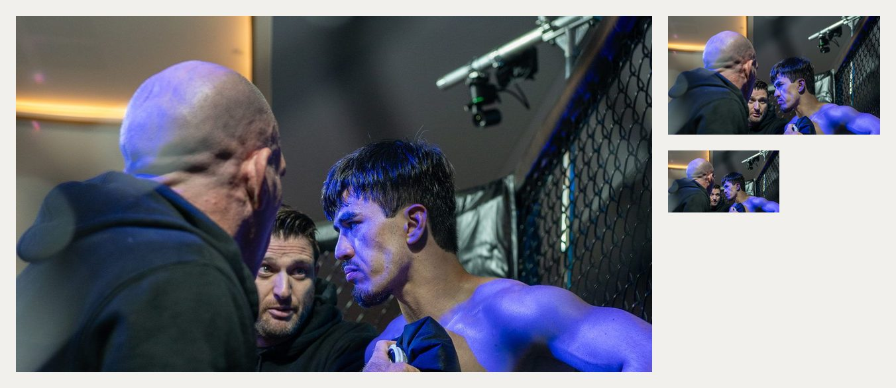

Video SEO for a small business comes down to one rule most people never hear about. Google will only show your video in search if it sits on a page that exists to show that video. Put the same clip halfway down your home page or under a product description, and Google treats it as decoration.

The short answer: give each video that matters its own page, with the video at the top, a title and description written for that video, and a proper thumbnail. Put the same video on YouTube with a searchable title and chapters. Then check Search Console to see what Google actually picked up.

I shoot and edit video for businesses around Bathurst and the Central West, and I build websites. The two meet here. It is easy to pay for a good video, drop it into the home page, and never see it turn up in a search.

## Why Google ignores most videos on business websites

In December 2023 Google changed how video results work. Clicking a result in the Videos tab now only [leads to pages where the video is the main content](https://developers.google.com/search/blog/2023/12/video-is-the-main-content). Google listed the kinds of pages that no longer count:

- blog posts where the video supports the text
- product pages with a supplementary video
- pages that list several videos with none more prominent than the others

That describes most small business websites. The brand film on the home page, the walk-through on the services page and the gallery of reels on a "Media" page all fall outside it. The video still plays for anyone who visits. It just will not bring anyone new in from the Videos tab or the video results.

Google calls the page it wants a watch page. Its own definition is a page whose [main purpose is to show users a single video](https://developers.google.com/search/docs/appearance/video), with a title and description unique to that video.

## What a watch page looks like

It is a normal page on your site, built around one video. For a local business that might be:

- a two-minute venue tour, at an address like `/venue-tour`
- a how-to video answering a question customers ask on the phone
- an event highlight film with a short write-up of the night
- a product video for the one product you most want to sell

The video sits at the top, big enough to be the obvious thing on the page. Underneath goes text that describes what is in it: who, what, where, and a few lines a customer would actually want to read. A transcript or a summary of the key points helps people who will not press play, and it gives Google words to match against a search.

You do not need a watch page for every clip. Most social cuts live on Instagram and Facebook and never need to be found on Google. Pick the two or three videos that answer something people search for and give those their own pages.

## The checklist for each watch page

Google's [video SEO guidelines](https://developers.google.com/search/docs/appearance/video) and its [video structured data documentation](https://developers.google.com/search/docs/appearance/structured-data/video) boil down to a short list.

| Item | What to do |
|---|---|
| Page title | Name the video in words a customer would search, not "Video 1" |
| Placement | Video near the top, the most prominent thing on the page |
| Thumbnail | A deliberate frame, at least 60 x 30 pixels, at a stable address Google can crawl |
| Structured data | `VideoObject` markup with at least `name`, `thumbnailUrl` and `uploadDate` |
| Description | A short written summary on the page, unique to this video |
| Player | Loads with the page, not only after a click |

The last row is the one that catches people out, and it overlaps with page speed.

## The page speed trade-off

A common trick for speeding up a page is to show a still image of the video and only load the real player when someone clicks it. It saves a lot of weight on the first load, and I use it on pages where the video is supporting the text.

On a watch page it works against you. Search Console has a specific error for it: [cannot determine video position and size](https://support.google.com/webmasters/answer/9495631?hl=en), which Google says happens when the player is not on the page until someone clicks. Its guidance is to load the player at its real size and position without needing a click.

So the rule I build to is simple:

- **Watch pages:** load the real player, sized properly, so Google can see it.
- **Every other page:** a click-to-load placeholder is fine, because Google will not index that video as the main content anyway.

That keeps the home page fast and still gives the important videos a fair go in search. The [web design page](/services/web-design.html) has more on how I build for speed.

## Pick the thumbnail yourself

The thumbnail is what people see in search results before they decide to click. Left alone, a video player or YouTube will grab a frame for you, and it is often someone mid-blink or a blurry transition.

That frame is a still from a fight night, which is the kind of event I cover in [video](/video.html) and [sport photography](/photography/sport-fitness.html). It works small because it has one clear subject, faces close to the camera and plenty of contrast. A wide shot of the whole room would turn to mush at that size.

If you are paying for a shoot, ask for a few stills on the day for this. A purpose-made thumbnail beats any frame pulled from the footage.

## YouTube is still the easiest way in

YouTube videos show up in Google results, and a YouTube video page is built around one video, which is exactly what Google wants. For most small businesses, the practical answer is both: upload to YouTube, and embed the same video on its own page on your site.

On YouTube, the parts that matter:

- **Title.** What the video is and where, in plain words. "Pump station upgrade, Oberon" beats "Project update".
- **Description.** The first couple of lines say what the video covers. Then a link back to the matching page on your site.
- **Chapters.** Timestamps in the description let Google show key moments from the video in search. YouTube's rules for [manual chapters](https://support.google.com/youtube/answer/9884579?hl=en) are that the first timestamp is 00:00, there are at least three in ascending order, and each chapter runs at least 10 seconds.
- **Captions.** Check the automatic ones. Town names and trade terms are often wrong, and so is "Bathurst".

## Do not forget Google Business Profile

For a local business, the profile is often seen more than the website. Google takes video there too: [up to 30 seconds, up to 75 MB, at 720p or higher](https://support.google.com/business/answer/6103862?hl=en). A short clip of the shop, the work or the team is enough. My [Google Business Profile checklist](/guides/google-business-profile-checklist.html) covers the rest of the profile, and the post on [social media video sizes](/blog/social-media-video-sizes.html) covers which shapes to export for each place.

## How to check it worked

Search Console has a [video indexing report](https://support.google.com/webmasters/answer/9495631?hl=en) that lists which pages Google found a video on and which ones it decided not to index, with the reason. If your watch page shows "Video isn't on a watch page" or "Video is not the main content of the page", the video is not prominent enough or the page is trying to do too many things at once.

If the page itself is not in Google yet, sort that first. The post on [why a website does not show up on Google](/blog/website-not-showing-on-google.html) walks through it.

## Where to start

You do not need a video strategy document. Take the one video you already have that answers a real customer question, give it its own page with the checklist above, put it on YouTube with chapters, and check the report a few weeks later. Then do the next one.

I shoot video and build websites for businesses in Bathurst, Orange, Lithgow, Mudgee, Dubbo and across the [Central West](/locations.html), and I set up [SEO](/services/seo.html) so the work gets found. If you have video that nobody is finding, or a shoot coming up and want it planned for search from the start, [get in touch](/contact.html).
