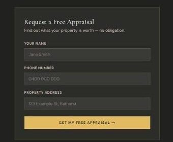

If a customer tells you your website is "not secure", or Chrome now stops them with a full-page warning before your site loads, it is almost always the same root cause: some part of the trip to your site still uses plain HTTP instead of HTTPS. Chrome has become much less forgiving about that this year, so a website not secure warning that used to be a small grey label in the address bar can now be the first thing a new visitor sees.

The short answer: make sure every address that leads to your site works over HTTPS, not just the home page. That means the bare domain, the www version, any old domain that redirects to the new one, and any link printed on a flyer or a QR code. Then make sure the certificate renews itself, because certificates now expire much faster than they used to.

## What changed in Chrome

Google announced in October 2025 that Chrome would turn on a setting called "Always Use Secure Connections" for everyone [from Chrome 154](https://security.googleblog.com/2025/10/https-by-default.html). Google said that would land in October 2026, and Chromium's release calendar had Chrome 154 reaching the [stable channel in September 2026](https://chromiumdash.appspot.com/schedule). If your customers keep Chrome up to date, this is now their default.

With that setting on, Chrome tries HTTPS first. If a public site cannot be reached over HTTPS, Chrome asks the visitor for permission before loading the insecure version. Google's own notes say a few things worth knowing:

- It only warns on a site the person has not visited recently. Regulars are not warned again and again.
- Chrome [remembers the visitor's choice for 15 days](https://chromium.googlesource.com/chromium/src/+/main/docs/security/ask-before-http/ask-before-http-adoption-guide.md), and renews it each time they come back.
- Private addresses, like a router page or an office intranet, are left out.

So the people who see the warning are exactly the ones you want: someone who found you on Google, scanned your QR code or clicked an old link and has never been to your site before. A full-screen warning is a poor first impression.

## Why does my website say "not secure" when I have a certificate?

This is the question I get most, and it usually comes down to one of four things.

1. **A redirect step without HTTPS.** The warning appears, then the visitor lands on your proper HTTPS page. Fix: make every step in the chain support HTTPS.
2. **The certificate expired.** Visitors get a red "Your connection is not private" page. Fix: turn on automatic renewal with your host.
3. **The certificate only covers one name.** The www address works and the bare domain does not, or the reverse. Fix: a certificate that covers both.
4. **Mixed content.** The page loads but the padlock is missing, or a form or script fails. Fix: change the old http:// links inside the site.

The first one catches a lot of small businesses, and it is the one the new Chrome warning targets directly. Google's guide for site owners says that if any redirect step does not support HTTPS, Chrome [will show the warning](https://chromium.googlesource.com/chromium/src/+/main/docs/security/ask-before-http/ask-before-http-adoption-guide.md) even though the visitor ends up on a secure page.

Here is how that happens in practice. A business changes its name or moves from an old domain to a new one. The old domain is kept and pointed at the new site, but nobody puts a certificate on the old domain because "it just redirects". Every customer who types the old address, or follows an old link from a directory listing, now gets a warning before they reach the perfectly secure new site.

Printed material is the other trap. If your ute signage, your business cards or a QR code on the shop counter says http:// in front of your address, that is the first hop in the chain. You cannot reprint every flyer, so that address has to work over HTTPS.

## Certificates now expire much faster

The second change this year is less visible. The industry body that sets the rules for website certificates voted to [shorten how long a certificate can last](https://cabforum.org/2025/04/11/ballot-sc081v3-introduce-schedule-of-reducing-validity-and-data-reuse-periods/). The schedule, as summarised by [DNSimple](https://support.dnsimple.com/articles/announcement-ssl-certificate-validity-changes/), is:

| From | Maximum life |
|---|---|
| 15 March 2026 | 200 days |
| 15 March 2027 | 100 days |
| 15 March 2029 | 47 days |

If your certificate was bought once a year and installed by hand, that routine is already broken, and by 2029 it will be unworkable. The answer is automatic renewal. Google's guide for site owners notes that common web servers can [fetch certificates automatically](https://chromium.googlesource.com/chromium/src/+/main/docs/security/ask-before-http/ask-before-http-adoption-guide.md), that many certificate authorities now issue them free, and that modern hosts support HTTPS even if you have to switch it on. If your host charges you yearly for a certificate and a person has to install it, that is worth a conversation.

## Mixed content: the padlock that goes missing

Sometimes the address is fine but the page itself pulls in something over plain HTTP: an old logo, an embedded form, a booking widget or a script pasted in years ago. That is called mixed content. Browsers [upgrade or block it](https://developer.mozilla.org/en-US/docs/Web/Security/Mixed_content): images, audio and video are quietly switched to HTTPS, but scripts, stylesheets and embedded frames loaded over HTTP are blocked outright.

That matters more than the padlock. A blocked script can mean a quote form that never sends, a booking calendar that shows a blank box or a menu that will not open on a phone. The site looks broken and nobody tells you, because the customer just leaves.

On WordPress sites, mixed content usually comes from images and links saved in the database before the site moved to HTTPS. A search-and-replace on the database fixes most of it, but take a backup first.

## Does HTTPS affect Google rankings?

It is part of how Google judges a page. Google's page experience guidance asks site owners whether their [pages are served in a secure fashion](https://developers.google.com/search/docs/appearance/page-experience). On its own it will not lift a weak page above a strong one. The bigger cost is the visitor who sees a warning and goes back to the search results.

If your site is also not showing up on Google at all, that is a separate problem. My post on [why a website is not showing on Google](/blog/website-not-showing-on-google.html) walks through how to tell the difference.

## A quick check you can do today

You do not need any tools for most of this. Open Chrome, go to Settings, then Privacy and security, then Security, and make sure "Always use secure connections" is on. Then type each of these into the address bar, one at a time:

1. `http://yourdomain.com.au`
2. `http://www.yourdomain.com.au`
3. Any old domain you used to use, with http:// in front
4. The address printed on your flyers, signage or QR codes

Each one should land on your site with a padlock and no warning. Then open your contact or quote form and send yourself a test message. If any of those fail, you know which link in the chain to fix.

The fixes are usually small: a certificate added to an old domain, auto-renewal switched on, a redirect changed or a few old links updated. If you are moving to a new domain or a new platform, plan the HTTPS side as part of the move. My guide on [moving a website without losing rankings](/guides/move-website-without-losing-rankings.html) covers the redirect side of that in more detail.

## Who looks after this for you?

Certificates, redirects and domain renewals are exactly the jobs that fall through the cracks on a small business site, because nobody owns them until something breaks. They are part of what I do under [website maintenance](/services/website-maintenance.html): renewals tracked, redirects checked and forms tested after changes. Sites I built, like the [BX Realty site](/work/bx-realty.html), stay looked after by the person who built them. If you only want it checked once, the [support page](/support.html) explains casual work by the hour.

I am based in Bathurst and work with businesses across the Central West, from Orange and Lithgow to Mudgee and Dubbo. If Chrome is warning people away from your site, or you are not sure whether it will, send me your domain and any old addresses you still own. I will check every one and tell you plainly what needs fixing. [Get in touch](/contact.html).
