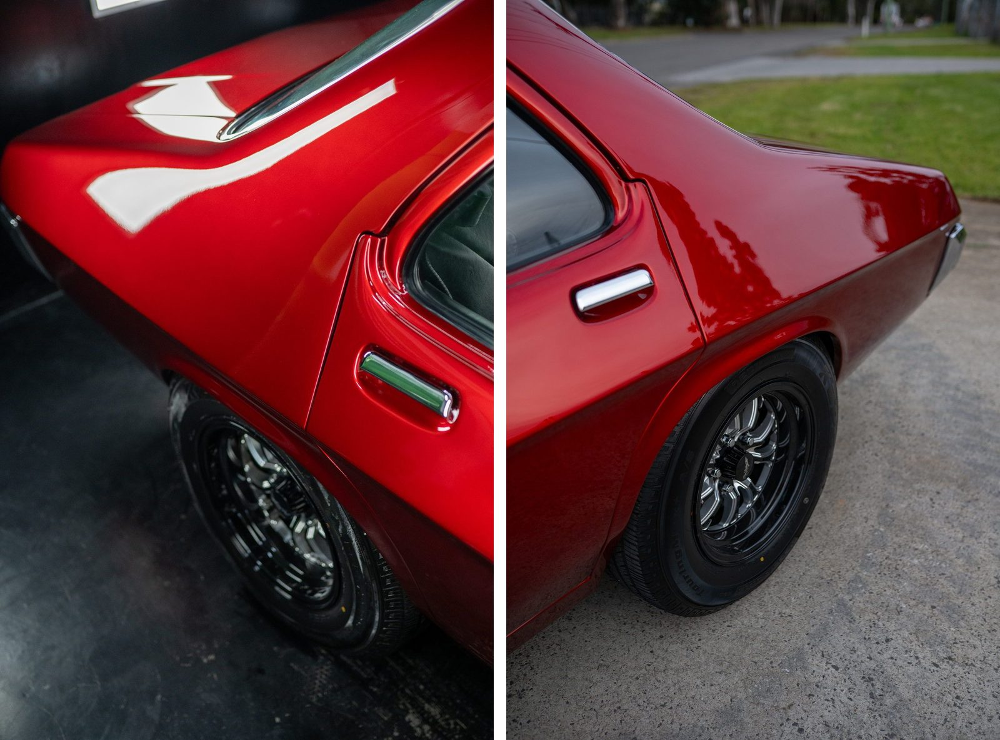

Car dealership photography decides whether a buyer in Orange or Dubbo bothers to drive to your yard. In a regional town, most people looking at a used car have already scrolled through it on their phone before they ring. The photos are doing the first inspection for you.

The short answer: photograph the actual car, every time, in the same spot and the same light. Aim for at least 20 photos covering the outside, the inside and anything the listing claims. Lead with a front three-quarter view. Show the marks and the wear. Keep logos and text off the pictures.

## How many photos does a car listing need?

carsales gives dealers a rule of thumb of [at least 20 photos for each vehicle](https://business.carsales.com.au/insights/business-tips/maximising-ad-effectiveness-with-photos-and-video/), and names the angles it expects: three-quarter front, three-quarter rear, side, the dashboard and the rear interior. That is a floor, not a target. A ute with a canopy, a tray and a towbar needs more than a hatchback.

A simple way to think about it is in groups, so nothing gets missed when someone is shooting six cars before lunch:

| Group | Shots |
|---|---|
| Outside | Front three-quarter, side, rear three-quarter, straight front and rear |
| Details | Wheels and tyres, headlights, any badge or trim level marker |
| Inside | Dashboard from the driver's door, front seats, rear seats, boot or tray |
| Proof | Odometer, infotainment screen, reversing camera, sunroof, tow bar |
| Paperwork and extras | Service books, spare keys, owner's manual |
| Condition | Any scratch, dent, chip, worn seat or kerbed wheel |

The same carsales page makes the point that if the listing mentions an option, such as a sunroof, larger wheels or a particular screen, there should be a photo of it. If the ad says "full service history", photograph the books.

## Which photo should go first?

The first photo is the thumbnail in search results, so it has to work small. Google is explicit about this for its own vehicle ads: it recommends a main image taken [from the front at about 45 degrees](https://support.google.com/merchants/answer/11190670?hl=en) and says not to use a rear view as the main image.

Car buyers are used to that view, so I would use it on carsales, Facebook Marketplace and your own website as well. Turn the front wheels slightly so the face of the rim shows, not the tread. Shoot from around headlight height rather than standing eye level, which flattens the car and shows too much bonnet.

## One set-up for every car

This is where most yards lose the look. One car is shot in front of the workshop roller door at 9 am, the next on the forecourt at 3 pm with the sun behind it, the next half in shade. Scroll your stock list and it reads as random.

Pick one spot and use it for everything. A plain wall, a clean shed bay or the same corner of the yard with nothing behind it. carsales suggests keeping cars [out of direct sunlight](https://business.carsales.com.au/insights/business-tips/maximising-ad-effectiveness-with-photos-and-video/), with overcast days or shade giving more even results, and a background free of other vehicles, poles and bins.

A few habits keep it consistent from car to car:

- **Mark the floor.** Two strips of tape show where the wheels go. Another mark shows where the photographer stands for each angle.
- **Same height, same lens.** A phone is fine if it is the same phone and nobody uses the zoom on one car and not the next.
- **Same order.** Shoot the angles in the order they will appear in the listing. It saves sorting later.
- **Clean the car first.** Dust and water spots show in every frame and take longer to remove on a computer than with a cloth.

In winter around Bathurst and Oberon, a covered bay earns its keep. Wet concrete and grey skies are not a problem if every car is shot under the same roof.

## Show the wear

It is tempting to leave the chipped bumper out of the set. Do not. The buyer will see it when they arrive, after a long drive, and the sale starts with them wondering what else was left out.

A close-up of each flaw, with a line in the description, does more for trust than another glamour shot. It also saves a phone call explaining the scratch.

## Do not use stock photos or overlays

Google's image rules for vehicle ads are a useful standard even if you never run one. They say listings can be disapproved for [generic or stock images that do not show the actual car](https://support.google.com/merchants/answer/11190670?hl=en), for placeholders like "Coming Soon", and for watermarks or superimposed logos and text. Stock images are only allowed for new cars, and only when they match the make, model and colour listed.

That matters more than it used to. Google made vehicle ads available to [all Australian advertisers in February 2024](https://support.google.com/merchants/answer/14541481), fed from your stock list through Merchant Center. If your photos already meet those rules, the yard can use them there without reshooting.

The same page also notes that images edited or created with AI need to be labelled in several regions. Background-swap apps are popular with dealers right now. My view: cleaning up a stray bin is one thing, but anything that changes how the car itself looks is a description of the car, and it should be accurate.

## Size and file names

Google's guide asks for at least [500 by 500 pixels, recommends 1500 by 1500 or more](https://support.google.com/merchants/answer/11190670?hl=en), and suggests a 4:3 shape. Shooting in 4:3 and exporting at 1600 to 2000 pixels on the long side covers most places a used car ends up.

On your own website, name the files before uploading. `2019-hilux-sr5-front-three-quarter.jpg` tells a search engine something. `IMG_4821.jpg` does not. I covered the same habit for detailers in [how to take before and after photos](/blog/detailing-before-after-photos.html).

## Video walkarounds

A 60-second walkaround answers questions that photos cannot: the engine note, how the paint moves in light, the condition of the seats. Shoot it vertically for Reels and Marketplace, or plan the frame so it crops both ways. My post on [social media video sizes](/blog/social-media-video-sizes.html) covers the shapes, and the [video page](/video.html) has what I do.

## Your own website still matters

carsales and Marketplace bring the traffic, but they also put your car next to everyone else's. Your own stock pages are the one place where buyers see only your cars, your warranty and your phone number. A clean, consistent set of photos makes that page look like a business worth driving to. If the site is due for work, start with [web design](/services/web-design.html) or [SEO](/services/seo.html) for how the yard shows up in local search.

## Getting it done

Most yards can do this themselves with a phone, a marked bay and a written shot list. Where a photographer helps is setting the system up: choosing the spot, the light and the angles, and shooting the first batch so staff have a reference for every car after that. For hero stock, a prestige car or a classic, a full shoot is worth it. There is more about how I work with cars on the [automotive photography page](/photography/automotive.html), and the guide to [preparing for a commercial photo shoot](/guides/prepare-for-a-commercial-photo-shoot.html) covers what to have ready.

If you run a car yard, caravan dealer or machinery business anywhere in the Central West and want your stock photos to look like they came from one place, [send me the details](/contact.html) and I will come back with questions.
