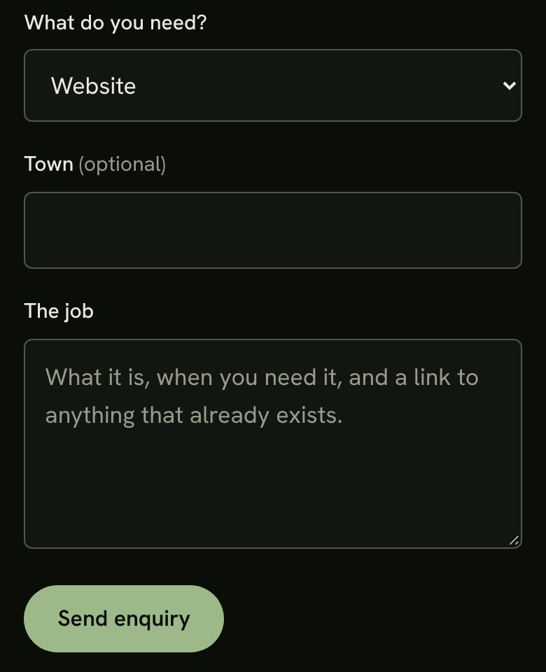

Website accessibility requirements in Australia are less clear-cut than most people expect. There is no law that says "your website must pass this test". There is a law that says you cannot treat people with disability less favourably when you sell them goods or services, and a website is one of the ways you do that. The practical standard everyone measures against is WCAG 2.2 at level AA.

The short answer for a small business: you are covered by the Disability Discrimination Act whether you are a council or a café, and the safest way to show you have taken it seriously is a site built to WCAG 2.2 AA. Most of that is ordinary good web building. Very little of it is expensive if it is done when the site is built.

## What the law actually says

The [Disability Discrimination Act 1992](https://www.legislation.gov.au/C2004A04426/latest/text) covers the provision of goods, services and facilities. The W3C's summary of Australian policy lists it as applying to [government, the public sector and the private sector](https://www.w3.org/WAI/policies/australia/), and notes that the Act itself does not name any version of WCAG.

The technical detail comes from the Australian Human Rights Commission, which administers the Act. In April 2025 it issued new guidelines on equal access to digital goods and services, which [recommend aligning with WCAG 2.2 Level AA](https://www.deque.com/blog/the-2025-ahrc-accessibility-guidelines-whats-new-and-why-it-matters/) and name PDFs, online documents, videos, emails and social media posts as part of what needs to be accessible. The [Commission's own guidelines page](https://humanrights.gov.au/our-work/disability-rights/publications/guidelines-equal-access-digital-goods-and-services) is the place to read them in full.

Government websites have a separate, stricter set of rules. The Commonwealth's Digital Experience Policy uses WCAG 2.2, but it applies to the [public sector only](https://www.w3.org/WAI/policies/australia/). If you sell to government, expect to be asked about accessibility in a tender. If you do not, the DDA is the part that matters.

I am not a lawyer, and this is not legal advice. There is a law, there is a recognised standard, and a site that ignores both is a risk you do not need.

## Who this affects

More people than most owners assume. The Australian Bureau of Statistics found that [5.5 million Australians, or 21.4 per cent, had disability in 2022](https://www.abs.gov.au/media-centre/media-releases/55-million-australians-have-disability), and that over half of people aged 65 and older did.

That last figure matters in the Central West. A lot of the customers for a Bathurst tradie, an Orange physio or a Mudgee accommodation business are older. Small text, low contrast and buttons that are hard to hit on a phone are not edge cases for them. They are the reason someone gives up on your quote form and rings the next business on the list.

## What is WCAG 2.2 AA?

WCAG is the Web Content Accessibility Guidelines, published by the W3C. Version 2.2 became a [W3C Recommendation on 5 October 2023](https://www.w3.org/WAI/standards-guidelines/wcag/new-in-22/). It has three levels, A, AA and AAA, and AA is the level everyone, including the Commission, points to.

Version 2.2 added a handful of checks that matter on small business sites:

| New check | Level | What it means in practice |
|---|---|---|
| Target size (minimum) | AA | Buttons and links at least 24 by 24 CSS pixels, or spaced well apart |
| Focus not obscured | AA | A sticky header or cookie bar must not cover the field someone has tabbed into |
| Dragging movements | AA | Anything you drag, like a slider, also works with a plain tap or click |
| Accessible authentication | AA | Logging in does not depend on a memory test or puzzle without another option |
| Redundant entry | A | People are not made to type the same details twice in one process |
| Consistent help | A | Your phone number or help link sits in the same place on every page |

The full list and wording are on the [W3C's page on what is new in 2.2](https://www.w3.org/WAI/standards-guidelines/wcag/new-in-22/).

## The faults most small business sites have

WebAIM tests the home pages of the top million websites every year. Its [2026 report](https://webaim.org/projects/million/) found detectable WCAG failures on 95.9 per cent of them, with an average of 56.1 errors per page. The most common faults were:

- Low-contrast text, on 83.9 per cent of home pages
- Images with no alt text, on 53.1 per cent
- Form fields with no label, on 51 per cent
- Links with no text, on 46.3 per cent
- Buttons with no text, on 30.6 per cent
- No page language set, on 13.5 per cent

Every one of those is a build fault, not a content fault. Pale grey text looks clean in a mock-up. A label that is only placeholder text vanishes as soon as someone types. An icon-only Facebook link reads as just "link" to a screen reader, with no clue where it goes.

## A ten-minute check you can do yourself

You do not need special software to find the worst problems.

1. **Put the mouse away.** Press Tab from the top of your home page. You should see a clear outline move from link to link, in a sensible order, and be able to reach and send your contact form with the keyboard alone. If the outline disappears or gets hidden behind a sticky header, that is a fail.
2. **Zoom to 200 per cent.** In Chrome, press Ctrl and the plus key a few times. Text should get bigger and reflow, without overlapping or running off the side.
3. **Read it on your phone outdoors.** If you squint at grey text in the sun, so do your customers.
4. **Start filling in your form.** If the label disappears as you type, the field relies on placeholder text and needs a proper label.
5. **Watch your own videos with the sound off.** If they make no sense without captions, add captions. Social video is listed in the Commission's guidelines too.
6. **Open your PDFs.** A menu, price list or brochure that is a scanned image cannot be read aloud. Put the key details on a web page as well.

The hero picture at the top of this post shows the first and fourth checks passing: a visible outline on the field the keyboard is in, and a label that stays above the box.

## Do accessibility widgets make a site compliant?

No. The overlay widgets that add an accessibility button to the corner of a site promise a quick fix, but they do not change the faults in the code underneath. In April 2025 the US Federal Trade Commission [finalised an order requiring accessiBe to pay US$1 million](https://www.ftc.gov/news-events/news/press-releases/2025/04/ftc-approves-final-order-requiring-accessibe-pay-1-million) over claims that its widget could make any website WCAG compliant. The FTC said the tool did not do that.

That is an American case, but the lesson travels: a widget is no substitute for labelled forms, readable contrast and a site that works with a keyboard.

## What it costs to get right

The cheapest time to build accessibility in is when the site is built. Contrast, labels, heading structure and keyboard focus cost almost nothing to do properly from the start, and the [web design](/services/web-design.html) page lists readable contrast, proper headings and keyboard-friendly forms as part of every build. Retrofitting an existing site varies. Some fixes are an afternoon. A theme with low-contrast colours baked in, or a page builder that writes messy code, can be more work than replacing it. My [comparison of website platforms](/guides/website-platforms-compared.html) covers how much control each one gives you over this.

Alt text and captions are ongoing. Every new photo and video needs them, so they belong in the routine of [looking after a site](/services/website-maintenance.html), not a one-off fix. If you are getting [video made](/video.html) for social media or your website, ask for a caption file with it, so the captions are accurate rather than auto-generated.

## Getting your site checked

I am based in Bathurst and build and look after websites for businesses across the Central West, from Orange and Lithgow to Dubbo and Cowra. If you want to know where your site stands, send me the address. I will go through the keyboard, contrast, forms, images and video, and tell you plainly what needs fixing and what can wait. [Get in touch](/contact.html).
